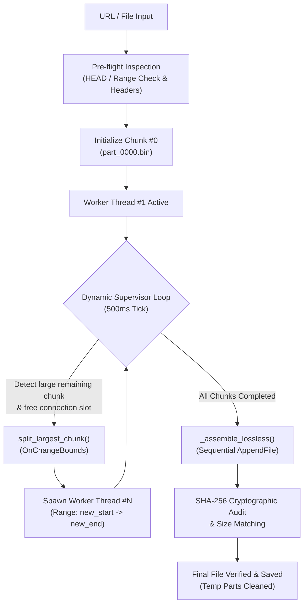

# ⚡ REA Dynamic Multi-Part Downloader & Scheduler

[](https://github.com/mohamedsharshar/rea-dynamic-downloader/actions/workflows/ci.yml)
[](https://www.python.org/)
[](https://microsoft.com/windows)
[](LICENSE)
[](#architecture--data-flow)

> A high-performance, multi-threaded downloader engineered in Python, inspired by decompiled and reverse-engineered data flow logic from **Internet Download Manager (IDM)**. Features adaptive dynamic chunk splitting, per-file manual bandwidth throttling, modern native dark GUI, and cryptographic SHA-256 verification.

---

## 🌟 Key Highlights & Features

- **⚡ Dynamic Segment Chunking (IDM-style):**
  Instead of dividing a file statically at the start, the supervisor monitors all active threads in real time. If a thread is downloading slowly or another finishes early, the engine dynamically discovers the largest remaining chunk (`FindMaxFreeChunk`) and splits it live (`OnChangeBounds`) into a new parallel connection.

- **🎚️ Per-File Bandwidth Limiter (Speed Throttle Slider):**
  A custom, non-blocking throttle slider for each download task. You can limit one file to `256 KB/s` while allowing another file to run at full bandwidth.

- **🔒 Lossless Assembly & SHA-256 Cryptographic Verification:**
  Reassembles chunks sequentially via streaming buffer blocks (`AppendFile` equivalent) and calculates a triple-check SHA-256 fingerprint to guarantee zero byte corruption.

- **🎨 Modern Native Dark UI & Taskbar Integration:**
  Built with Tkinter and styled with the Catppuccin Mocha palette. Leverages the Windows Desktop Window Manager (`DwmSetWindowAttribute`) for a native immersive dark title bar, standard taskbar presence, and smooth minimize-to-background operation.

- **🛡️ Single-Instance Mutex Lock:**
  Uses a Windows Global Named Mutex (`Global\REA_Dynamic_Downloader_SingleInstance_Mutex_v2`). Launching a second instance automatically restores and brings the existing window to the foreground, preventing duplicate background processes.

- **🧠 Advanced Filename & MIME Sniffing:**
  - Standard & RFC 5987 / RFC 6266 encoded `Content-Disposition` headers (e.g. `UTF-8''...`).
  - Query parameter fallback (`?mime=`, `?filename=`).
  - **Magic Bytes Binary Inspection:** Sniffs the raw header bytes (e.g., `MZ` for `.exe`, `ftyp` for `.mp4`, `%PDF-`, `PK` for `.zip`, Matroska EBML for `.mkv`) to guarantee accurate extensions even when web servers omit them.

---

## 🏗️ Architecture & Data Flow



---

## 🚀 Getting Started

### 1. Run with Python (No third-party packages required)

The core application runs on pure Python standard libraries:

```bash
# Clone the repository
git clone https://github.com/mohamedsharshar/rea-dynamic-downloader.git
cd rea-dynamic-downloader

# Run the application
python rea_dynamic_downloader.py
```

### 2. Build as Standalone Executable (`.exe`)

You can compile it into a single, portable Windows executable:

```bash
pip install pyinstaller
python -m PyInstaller --clean --onefile --noconsole --name "REA_Dynamic_Downloader" rea_dynamic_downloader.py
```

The resulting executable will be in the `dist/` directory.

### 3. Run Automated Tests

To run the built-in test suite (verifies sanitization, RFC 5987, Magic Bytes sniffing, dynamic chunk math, and lossless SHA-256 assembly):

```bash
python -m unittest discover tests
```

---

## 💻 Technical Implementation Details

| Component | Engineering Implementation |
|---|---|
| **Concurrency Model** | `threading.Thread` + `threading.RLock()` to ensure re-entrant safety during live chunk splitting |
| **UI Event Loop** | Lock-Free UI Synchronization via `root.after()` to guarantee 60 FPS responsiveness and prevent "(Not Responding)" states |
| **HTTP Transport** | `urllib.request` with custom `Range: bytes=X-Y` headers and bounded buffer reads (`min(BUFFER, rem)`) |
| **Data Integrity** | Incremental `hashlib.sha256` hashing during lossless concatenation |
| **Windows API** | `ctypes.windll.user32` + `kernel32` (Named Mutex) + `dwmapi` (Immersive Dark Title Bar) |

---

## 📄 License

This project is licensed under the MIT License - see the [LICENSE](LICENSE) file for details.
